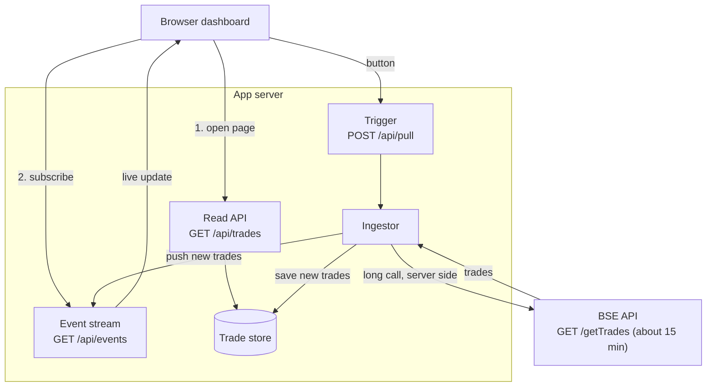
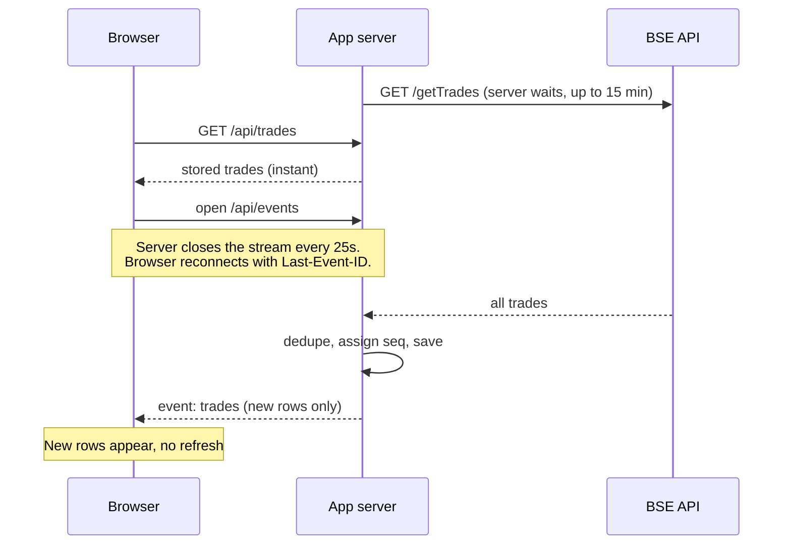

# Architecture note

## The problem

- BSE's `/getTrades` takes up to 15 minutes.
- Our network kills any HTTP connection held open longer than 30 seconds.
- The dashboard must open instantly, show existing trades during a pull, and show new trades when a pull
  completes, with no refresh, no polling loop and no scheduler.

## Diagram

### Timeline of one pull

## Why this design

1. **The 15-minute call is never tied to a browser request.** The ingestor runs inside the server and owns the
   long call to BSE. The browser only ever makes short requests: a snapshot read and a 202 trigger.
2. **Reads never wait on BSE.** The dashboard reads the store, so it opens instantly and keeps working during a pull.
3. **Push, not poll.** When a pull completes the server broadcasts a `trades` event over Server-Sent Events.
   There is no timer in the browser that asks the server for updates (the only timer is a local elapsed-time clock).
4. **SSE survives the 30-second rule by design.** The server ends each stream after about 25 seconds.
   `EventSource` reconnects on its own and sends `Last-Event-ID`, so the server replays anything missed in the gap.
   This is the browser's built-in reconnect, not an application polling loop.
5. **Every trade carries a `seq`.** `seq` increases once per completed pull that adds trades. It powers both
   reconnect replay and `GET /api/trades?after=<seq>`. The client also dedupes by `tradeId`.
6. **No scheduler.** A pull starts once on boot and then on demand (button or `POST /api/pull`). Only one runs at a time.

## Assumptions and limits

- **The 30s limit is on the browser-to-server path.** The server-to-BSE call is assumed to be exempt (for example,
  the ingestor runs on a host with unrestricted egress). If your network also kills that outbound call, BSE would
  need an async or resumable contract (submit job, get a job ID, fetch the result), and only `startPull()` changes.
- **Storage is a JSON file** to keep the repo dependency-free. In production, use Postgres with a `seq` column
  and a unique key on `trade_id`.
- **One app instance.** To scale out, run the ingestor as a single worker and fan out events with Redis pub/sub or
  Postgres `LISTEN/NOTIFY`.
- **Pull failures** are shown on the dashboard and earlier trades stay visible. There is no automatic retry
  (that would be a scheduler); use the button.
